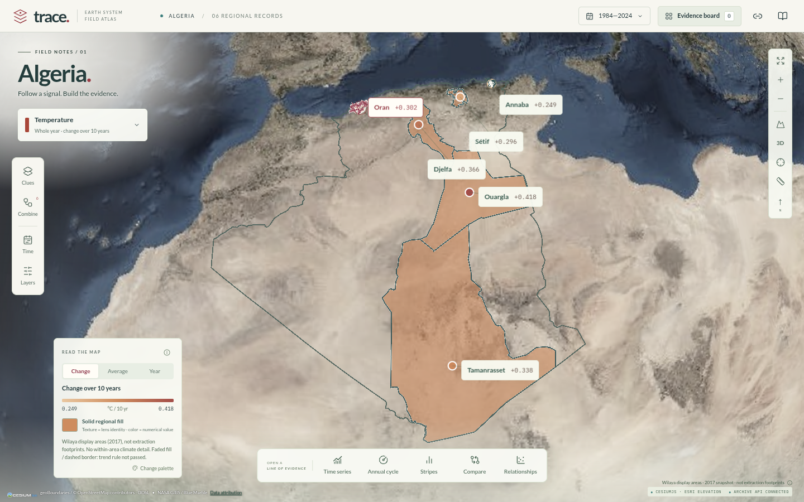

# TRACE — Earth System Field Atlas

**Map first. Follow a signal. Build the evidence.**

A redesigned investigation workspace for six supplied Algerian regional records, built with **CesiumJS, HTML/CSS/JavaScript, Tailwind CSS, Apache ECharts and restrained GSAP motion**, plus a same-origin **read-only Node data API**.

This is an independent NASA Space Apps 2026 concept for “Be an Earth System Trend Detective!” It is not an official NASA, Copernicus, ESA or Cesium application.



## Version 2.1 — interactive wilaya map refresh

The approved layout, seven clues, analysis windows, Time lens and evidence board are preserved. This update changes the map, not the scientific results:

- **Six real, selectable wilaya shapes:** Oran, Annaba, Sétif, Djelfa, Ouargla and Tamanrasset. Hover for the numerical record; click/tap the shape to inspect it; Fly to area fits its real bounds.
- **Dated administrative display proxies:** fixed **2017 geoBoundaries / OpenStreetMap, historical 48-unit snapshot**. These are not certified current legal boundaries or verified Giovanni extraction footprints. They do not establish whole-wilaya climate coverage.
- **Six named map textures**, one for each diagnostic (table below). Texture means lens identity, not event locations, fine-scale data or uncertainty. A uniform regional color represents the actual trend, period average or selected-year value.
- **Working map legend controls:** Change / Average / Year. Layers includes area visibility, texture visibility and fill opacity. Unsupported trends are faded with dashed borders; the support-only filter hides their polygons as well as their labels.
- Local, attributed GeoJSON, original upstream geometry, provenance hashes and the ODbL license are included. The labelled SVG fallback retains the same selectable areas when WebGL/the SDK is unavailable.
- All climate observations, thresholds, definitions and **1,620 numerical views are unchanged** from v2.0; only geographic provenance/limitations were added to the prepared payload. See `analysis/geography-data-regression.json`.

## Retained version 2 workspace

- **A full-width map canvas:** approximately 94% of the tested desktop/mobile viewport; no permanent data sidebar or fixed chart column. Compact Clues, Combine, Time and Layers panels open only when needed.
- **Useful real Cesium interactions:** geographic pan/zoom, Fit Algeria, regional fly-to, terrain inclination, north reset, true 2D/3D morphing, geographic context probe and WGS84 geodesic measurement.
- **Seven curated clues, not an archive-sized variable menu.** Original scientific names and source families live under Methods & sources.
- **Six transparent combinations** of two or three permitted inputs. Colors represent an actual joint-event frequency or rainfall-product difference, never an arbitrary score.
- **Five independent analysis windows:** time series, annual cycle, climate stripes, compare regions and relationships. Desktop windows move by dragging or arrow keys and resize, expand, duplicate, minimize to a tray, follow the map or freeze. Mobile windows adapt to the viewport.
- **A collectable, sortable evidence board:** frozen chart previews, chart-specific numerical summaries, notes, manual drag/arrow order, type/clue/region/newest sorting, revisit and JSON export. Cards remain local to this browser.
- **One Time lens:** period + whole-year/seasonal aggregation + change/average/year inspection. Whole-year logic is retained. “Change over 10 years” is the fitted slope × 10, not an end-point difference.
- Numerical stripe legends, zero-anchored comparison bars with slope intervals, monthly distribution envelopes, year-colored relationship points, fixed-baseline anomalies and optional detrending.
- **Exports that match each chart:** plotted/native-unit CSV, high-resolution PNG with legend/method context, full analysis JSON and selection-only sharing links.
- Explicit local-imagery, ellipsoid, WebGL/SDK, static-data and browser-storage fallbacks. No invented relief, climate pixels or missing observations.

## Start the included release

1. Extract the complete ZIP.
2. Open a terminal in the folder containing `package.json`.
3. Install a current Node LTS if needed (Node 22+ recommended; package minimum 20.19, sandbox-tested on 20.20.2).
4. Run:

```sh
npm start
```

Open **http://localhost:5173**. On Windows, `npm.cmd start` also works. Do not double-click `index.html`.

The release ZIP contains `dist/`; the built-in production server uses Node’s standard library, so no `npm ci` is needed just to run the included build. Keep `server/` and `public/data/atlas.json` alongside it. Internet access is needed for the external context imagery/elevation; explicit local fallbacks remain available.

### Develop or rebuild

```sh
npm ci
npm run dev
# or:
npm run build
npm start
```

The server binds `0.0.0.0`, accepts the hosted-preview origin and serves the UI and `/api/*` from one origin. Browser code does not call a second localhost service. Deployment paths currently assume the site root `/`, not a repository subdirectory.

No key is needed for the supplied archive, local SDK, boundary or local basemap. Public NASA GIBS imagery and Esri elevation are currently attempted without credentials, subject to provider terms/availability. A restricted **public** Cesium ion browser token is optional; see [Deployment](docs/DEPLOYMENT.md). Never put private secrets in `VITE_*` variables.

## The seven clues

| Requested concept | Interface label | Actual record | Do not interpret as |
|---|---|---|---|
| T2M | Temperature | `T2M`, °C | A projection or future scenario |
| VPDkpa | Air drying | `VPD_kpa`, kPa | Measured soil drought or independent temperature evidence |
| GWETROOT replacement | Water balance | `P_minus_E`, mm/day | Root-zone soil wetness, groundwater or usable water |
| PRECTROOT, confirmed as MERRA-2 rain | Rainfall · model | `PRECTOTCORR_m2`, mm/day | A new or separate PRECTROOT measurement |
| PRECIPGPM | Rainfall · satellite | `PRECIP_gpm`, mm/day; 2001–2024 | A 41-year IMERG record |
| SOLAR | Solar energy | `SWGDN`, kWh/m²/day | Photovoltaic electricity production |
| CLARITY | Clarity clue | `AOD_total`, aerosol optical depth | Measured visibility, surface pollution or a validated clarity index |

GWETROOT was not supplied. The authorized replacement is a **different available quantity**, not fabricated soil moisture. Solar and Clarity remain separate clues. Lower AOD means less column aerosol extinction; clouds and other factors also affect surface solar energy.

## The six combinations

`P90` and `P10` below are **local calendar-month percentiles fixed to 1991–2020**. Inequalities are strict. Joint-condition layers count months meeting **every** condition; each monthly value is 0 or 100 and yearly/complete-season means are percentages of months.

| Layer | Inputs and logic | Map texture | Map units / limitation |
|---|---|---|---|
| Heat + dry air | T2M > P90 AND VPD > P90 | Thermal diagonals | % of months; temperature is an input to VPD |
| Heat + rainfall shortfall | T2M > P90 AND MERRA-2 rain < P10 | Rainfall stipple | % of months; relative shortfall is not absolute drought |
| Heat, dry air + low rain | All three conditions above | Three-clue crosshatch | % of months; exploratory co-occurrence, not a stress/hazard score |
| Two rainfall stories | IMERG − MERRA-2, paired 2001–2024 | Paired rainfall bands | mm/day; disagreement, not bias against ground truth |
| Bright + low-aerosol months | SWGDN > P90 AND AOD_total < P10 | Solar lattice | % of months; not visibility, causal attribution or PV yield |
| Heat + water-balance shortfall | T2M > P90 AND P−E < P10 | Water-balance waves | % of months; not root-zone wetness |

Frequency trends use **percentage points / 10 years**, not relative percent growth. Exact monthly cutoffs, units, reference sample sizes and cautions are available in each analysis’s methods/JSON. These exploratory diagnostics are not independently validated hazard indices. [Full equations and assumptions →](docs/SCIENCE.md)

## A short investigation

1. Choose **Temperature** in Clues. Hover or select a wilaya display area, read its rate and open the record. The accessible labels work too.
2. Use **Time** to choose the full or shorter record, Whole year or a complete season, and Change, Typical conditions or Inspect a year.
3. Open another analysis from the bottom dock. Compare regional slopes, examine the monthly distribution or inspect anomalies. Click a series observation, stripe or relationship point to inspect its actual year; click a comparison bar to select that region.
4. Try a combination, then read its explicit conditions and limitations. In a relationship window, compare unadjusted and detrended association. Do not confuse association with a driver or cause.
5. Choose **Collect evidence**, arrange the frozen cards, and write what the result does—and does not—show. Export to preserve the context, not just the picture.

The default Oran whole-year temperature record reproduces **+0.302 °C / 10 years**, with supplied MK q approximately **0.0031**. Statistical support is conditional on the documented test assumptions.

## Scientific boundaries

- **Six real wilaya polygons are administrative display proxies, not verified extraction footprints, point samples or proof of whole-wilaya measurements.** Geometry is a fixed 2017 historical snapshot, not a current-legal/time-varying boundary model. Six values are never interpolated into a detailed climate raster.
- NASA Blue Marble and real elevation are **geographic context**, not the resolution of these climate records. The supplied spatial PNG is an unchanged reference image, not a numerical raster.
- Whole-year values are **unweighted monthly means**, not day-weighted means or annual rainfall totals. Complete seasons require three months; December belongs to the following winter.
- IMERG and the paired rainfall difference begin in **2001**, not 1984. Nothing is extrapolated through the current year or into the future.
- Support requires **OLS p < .05 AND BH-adjusted Mann–Kendall q < .05**. Source versus recomputed multiple-testing families are retained. Temporal-dependence correction is not documented/applied.
- A fitted-mean confidence band is not a prediction interval. Sparse-event OLS is exploratory and unbounded; a constant event series has a flagged, degenerate zero-width OLS interval, not proof of zero event probability.
- Source-family metadata are supplied; exact upstream collection IDs, extraction geometry, processing lineage and redistribution permissions still need review. Reproducing CSV statistics is not independent validation of NASA extraction.

### Archive scope versus interface scope

The five original CSVs contain **57,816 monthly rows, six regions and 20 supplied variables**. Nineteen variables span 1984–2024; IMERG spans 2001–2024. Preparation `trace-prep-2` retains **28 archival metrics and 1,620 views**: the 20 supplied quantities, two legacy diagnostic metrics and six new combinations. Only the agreed **seven primary clues + six combinations** are selectable in the new interface.

Archived `DUST_SHARE` and the old GPCP-based `HOT_DRY` are retained for provenance/regression checks, not offered in the new combination menu. The new heat/rainfall combinations use **MERRA-2 rainfall**, not GPCP. The gauge-weight unit conflict remains flagged, unchanged and excluded from the curated suite.

## Reproduce the archive

Python is needed only to regenerate the archive, not to run TRACE. Tested with Python 3.13.18; scientific package versions are pinned in `requirements.txt`.

```sh
python -m venv .venv
. .venv/bin/activate
pip install -r requirements.txt
npm run geometry:prepare  # Offline from the bundled, SHA-verified 2017 source
npm run data:prepare
npm run test:data
```

The offline pipeline reads `public/data/raw/`, writes `public/data/atlas.json`, source SHA-256 hashes and `analysis/validation.json`. In the original workspace it can also copy the five named uploads from `/home/user/uploads`. It does not acquire new measurements. Raw files retain original precision; prepared JSON and chart/API tables use 10 significant digits in native units. [Sources & audit →](docs/SOURCES.md)

## Tests and browser validation

With the app running in another terminal:

```sh
npm run test:data
npm run test:api      # Starts its own temporary API server
npm test
npm run test:extended
npm run test:layers   # Polygons, all six textures, pointer/touch and failure paths
npm run test:smoke
```

Browser prerequisites:

```sh
npx playwright install --with-deps chromium
```

Set `TRACE_BASE_URL=https://your-host/` to test another root deployment. Tests use the full Chromium headless channel with SwiftShader and accelerated 2D canvas disabled; the separate headless-shell renderer stalled on textured-map screenshots in this sandbox. The flags and paused render loop are **test-only**, not application behavior. [Executed results and qualifications →](docs/QA.md)

## Project structure

```text
index.html                    Map-first shell, panels, dock, dialogs
src/main.js                   Selection, Time lens, board, sources, sharing
src/map.js                    Cesium geography, area picking, camera/tools, fallbacks
src/areas.js                  Numeric GeoJSON fills, borders, support and SVG fallback
src/map-layers.js             Six named textures, geometry and containment helpers
src/charts.js                 Five independent ECharts renderers and PNG composition
src/windows.js                Window lifecycle, movement/resizing, exports, collection
src/field.js                  Shared chart definitions, plotted data, metrics and CSVs
src/data.js                   Baselines, formatting, statistics and map color helpers
src/styles.css                Responsive layout, Tailwind, local fonts, reduced motion
server/api.mjs                Cached, validated, read-only archive API
server/serve.mjs              Production static + API server
scripts/prepare_data.py        Offline preparation and numerical audit
scripts/prepare_boundaries.py  SHA-verified historical wilaya subset, no interpolation
scripts/compound_lenses.py     Seven-clue interface and six transparent diagnostics
scripts/*test.mjs              Archive/API tests
scripts/*check.mjs             Core/extended browser checks
scripts/browser-smoke.mjs      Clean desktop/mobile screenshots and map diagnostics
public/data/raw/               Five unchanged source CSVs
public/data/algeria.geojson    Natural Earth country outline, not extraction polygons
public/data/study-wilayas.geojson  Six actual 2017 administrative display shapes
public/data/wilaya-display-metadata.json  Vintage, source, license, hashes and caveats
public/data/geography/         Unchanged upstream 48-unit geometry + source metadata
analysis/                     Latest verification reports and screenshots
```

The classic `/cesium/Cesium.js` Vite warning is intentional: the official SDK, workers and assets are copied locally instead of rebundling Cesium. Fonts and icons are local too.

The validated source + runnable-build ZIP can be recreated with `python scripts/package_release.py`. The packager checks the current reports and archive hashes, excludes dependencies/credentials/historical analysis, checks every ZIP entry against its source, and writes a sibling `.sha256` file. `node scripts/release-check.mjs /path/to/extracted/TRACE-algeria-atlas` verifies the included build without dependency installation. The optional `node scripts/terrain-check.mjs` needs the running app and external elevation access.

## Persistence, deployment and publishing

The board stores up to 80 cards, subject to browser quota, under `trace-board-v2` and `trace-board-sort-v2`. If storage fails, an explicit **in-memory only** warning appears; export before leaving. Notes are not sent to the API or included in selection-sharing URLs. This new board does not automatically import the old v1 notebook format; old keys are not deleted. There is no cross-device sync or board-import service.

- [Production deployment, optional keys and safe repository handoff](docs/DEPLOYMENT.md)
- [API reference](docs/API.md)
- [Validation handoff](docs/QA.md)
- [Third-party notices](THIRD_PARTY_NOTICES.md)

**Not completed or claimed:** live NASA ingestion, user accounts/database, verified regional extraction polygons, numerical climate rasters, future scenarios, an operational-service SLA or remote GitHub publication. Publication requires the owner’s secure authentication, repository-visibility choice and data-permission review. Never paste private credentials into chat.
